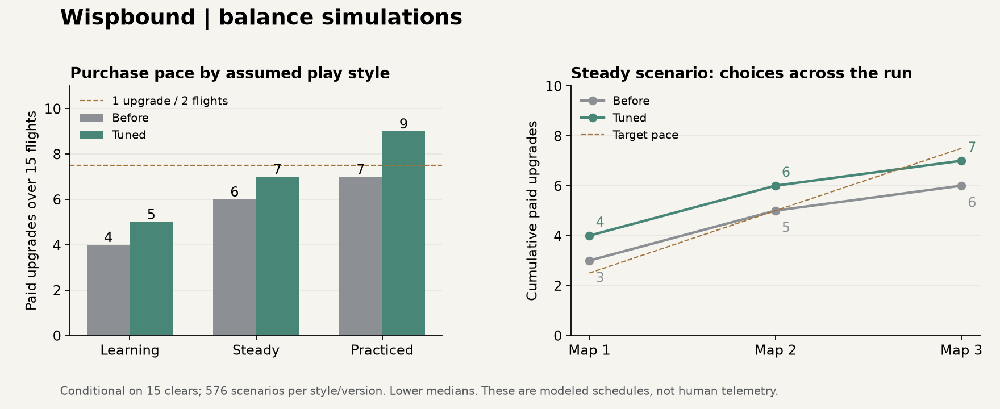

# Wispbound balance pass — 13 November 2026

Release: **balanced-sparks-1**. This pass follows the Clear Sparks UI/economy batch. It changes a few demonstrably weak trades and the skill price curve. It does **not** claim that a bot's completion rate predicts human enjoyment or phone difficulty.

## What changed

| Change | Reason and consequence |
|---|---|
| Skill price escalation: `1 + 0.40 × paidRanks^1.5` → `1 + 0.25 × paidRanks^1.5` | Keeps the first purchase and increasing commitment, but permits roughly 7–8 paid upgrades in a modeled 15-flight steady run instead of 6. Prices still round upward to multiples of 5. |
| Glass Lantern: **+4 Sparks per natural fuel pickup**, still **+1 Spark per paid Lift** | The former displayed +2 was usually a losing trade. One pickup now repays four Lifts of added effort. It still punishes missed fuel and does not guarantee safety. |
| Spark Wick preserves uses at full Sparks | A natural pickup that already fills the meter no longer wastes a finite restorative charge. Generated restoration still cannot create Packed Light or recursively trigger pickups. |
| Heavy Light: **+24 Sparks now**, with **+1 cost for the next 12 paid Lifts**, versus **+12 Sparks with no burden** | Replaces an unbounded whole-flight surcharge. Both choices have the same net fuel budget if all 12 payments occur. The bargain exchanges useful fuel later for immediate fuel/overflow now. Free Dream/artifact Lifts and unaffordable attempts do not repay the debt. |
| Reward pools omit Quiet Cinder when Lift already costs one | Avoids offering a pure discount with zero effect in the current build. It becomes eligible again with Glass Lantern's surcharge. TEST mounting stays unrestricted. |
| Corrected Glass Lantern/Overflow Coil explanation | The passive bonus is part of the natural pickup and can overflow. Generated Wick/Seed healing cannot. |

The changes do not add currency sources, alter the 30-Spark baseline, change ordinary 6/12/18 pickups, or silently remove the current overflow economy. Existing paid skills are retained; previously spent currency is not retroactively refunded.

## Method and coverage

The old scripts assumed portrait geometry, fractional Lift cost modifiers and four-second Dreams. New `balance-current-*` scripts use landscape dimensions, whole-Spark costs, current capacities, actual reward/support/settlement code and current artifact triggers.

| Layer | Executed coverage | What it can establish |
|---|---|---|
| Matched campaign comparison | **8,640 scenarios**: 3,456 before + 3,456 after, plus 864 sensitivities for each | Income, purchasing pace, wallet reconciliation, failure rollback, policy differences under declared capture/effort assumptions |
| Individual artifact comparisons | **9,984** per final sweep | Marginal fuel and income under a common schedule; does not price all sight/safety effects |
| Rest choices | **3,456** final counterfactuals | Immediate fuel/currency trade at 3, 15 and 30 starting Sparks; not full future value of hearts/capacity |
| Skill signatures | **54,760** marginal comparisons | Whether eligible purchases change runtime/recovery/capacity parameters |
| Combo stress | **219,744** cases; 14 fleets, 436 artifact sets | All singles/pairs and triples of nine trigger artifacts; caps and resource stability under scheduled opportunities |
| Map graph audit | **1,080 maps**, six topology recipes | Reachability, ordinary routes, Rest tradeoffs, known Dream destinations and restrictions |
| Actual flight engine | **432 flights at 60 Hz** | Real collisions/fuel/hold controls under a delayed heuristic controller; not human win rates or device FPS |

Additional preliminary sweeps compared +3 versus +4 Lantern fuel, price-growth coefficients 0.30/0.25, and all three starting roots. The paired report uses the corrected harness, not the preliminary results.

The campaign comparison covers all six ascensions, four companions, three assumed flying styles and four purchase policies. Each side uses six base campaign seeds. Sensitivity cases use separate seeds 101–106. The root comparison uses seeds 201 onward. Inputs share seed streams; different decisions consume different random draws, so this is not a perfect causal pairing of every pickup.

Inventory coverage includes **all 12 biomes and 48 authored map identities**. Layouts are cached representative realizations for each level/route/phase/row/duration, not every possible procedural seed. Aggregate fuel availability does not prove a feasible flight path can collect it.

### Modeling assumptions

Learning/steady/practiced are **scenario labels**, not measured populations. Base pocket capture probabilities are 45/60/76%; accessible pickups 68/82/94%; correction effort 16/8/2.5%; missed ability opportunities 45/25/10%. These deliberately include misses and waste. Capture, Collector rescue, visibility benefits, shield availability and Black Hole clearance are approximations.

The **conditional-clear** model continues resource accounting even when fuel would prevent a real clear. This isolates the economy over 15 flights. A separate **attrition** model imposes collisions and terminates an attempt after two unaffordable scheduled Lifts. Do not mix their completion rates or describe either as measured human survival.

The economy model uses production artifact triggers, but approximates opportunities to use them. It omits some information value, Night Gardener steering, precise companion travel, some terrain interactions and actual route geometry. It excludes spending on extra lives and additional companion slots to isolate the four starter roles. Combo stress grants multi-companion builds without acquisition cost, and is therefore an optimistic stress bound, not an attainable opening build.

## Results



Conditional on clearing all 15 flights, across ascensions 1–6:

| Assumed collection style | Paid upgrades before → after* | Total Packed Light income before → after* | First purchase after flight* |
|---|---:|---:|---:|
| Learning | 4 → 5 | 527 → 679 | 3 |
| Steady | 6 → 7 | 1,360 → 1,736 | 2 |
| Practiced | 7 → 9 | 2,435 → 2,990 | 1 |

*Lower-median estimator used by the harness; 576 scenarios per row per version. The ordinary statistical median for steady tuned purchases is 7.5. These are not predictions for an individual player.*

The steady tuned mean is **7.44 purchases / 15 flights**, close to the requested one purchase every two flights. Steady paths concentrating on main survival, conversion or saving each have a conventional median of 8; companion-first spending has 6. Ascension 1 is richer: the separate steady root comparison reaches a median of 10. We should watch this before applying a universal further price cut.

Sensitivity remains material. Steady schedules with 8 percentage points more capture reach a median of 9 upgrades; 12% more correction effort reaches 7. A deliberately generous +15% fuel upper bound reaches 10. Larger pickup rewards are therefore not a harmless difficulty adjustment: they also inflate upgrades through overflow.

The strongest sampled tuned full-run tree fill was about **21% of nominal ranks**, including the free starting node. Nominal ranks include mutually exclusive alternatives, so this is not a valid completion percentage for one legal path. It does establish that the tested spending policies did not come close to buying every tree. Your 60% limit is a ceiling, not a target; the more useful pacing target is purchases and meaningful branch depth.

### Artifacts and combinations

Across 384 matched Glass Lantern schedules, the old bonus reduced income by 9.31 Packed Light on average and caused 3.23 additional unaffordable Lifts. The +4 candidate increased income by 20.79 on average but still caused 1.38 additional unaffordable Lifts. That is a deliberate income-versus-safety trade, not a blanket buff to survival. A +3 candidate retained a weak reward for the extra risk.

Preserving Spark Wick charges increased its modeled mean marginal income from 1.34 to 5.24 indirectly, by saving fuel later. It never directly mints currency. Its modeled avoided unaffordable Lifts increased from 0.16 to 0.49 per schedule.

Combo stress retained the existing limits: **five work-fuel activations**, **four free-Lift grants**, and **12 seconds of overflow recovery per companion** per flight. The adversarial 10,000-event storm did not bypass these budgets or create recursive currency. Combined work-fuel bonuses cap at 16 internal units per activation. More companions can multiply the benefit of the shared recovery event, so the cap is not 12 total fleet-seconds.

The largest sampled incremental payout was **+220 Packed Light over 120 seconds**, for Sunheart Engine + Glass Lantern with Collector + Space Timer in a practiced schedule. This is finite and requires a particular build, but it remains a snowball risk with persistent boss artifacts. Stress starts with the artifacts already owned and does not model earning their slots. “No infinite loop” is not the same as “all combinations are balanced.”

### Routes and Rest

Every audited map had **5–9 normal complete paths**, an ordinary route to its finale, and no consecutive elites. All **3,402 branch points** differed in encounter category, reward theme or flight profile. Every map had paths with different Rest counts. Each Rest retained one known next flight for Dreaming. This validates structural consequence; it does not prove that the map communicates that consequence well enough.

Low-Spark Rest scenarios benefited from Grow & refill; healthy scenarios gained more immediate spendable currency from Condense. Rekindle's later-attempt value is deliberately absent from the one-flight comparison and should not be classified as useless from that result.

Recharge remains a concern: in the fixture containing a partly charged Wick, adding more uses rarely changed the next flight relative to taking Packed Light. The full-meter fix prevents waste, but this does not make recharge competitive with a major Rest boon in every build. Flash Stone's information value and later-flight charge consumption are not fully priced here.

### Companion caution

The real-flight controller cleared **66/432**, with 120 of its 366 collision deaths occurring below one paid Lift of fuel. It cannot reliably use Space Timer. Worse, its 250 ms timing setting cleared 47/216 versus 19/216 at 150 ms, showing a controller-policy artifact. These results are diagnostics, **not** evidence that a human should win 15% of flights or that Space Timer needs a huge buff.

Resource scheduling favors sustained levitation; geometric steering with this controller favors Collector. That disagreement is a reason to calibrate against real play before changing companion strengths dramatically. No role was nerfed or buffed solely to equalize these bot scores.

## Three substantial design issues to rethink

1. **Survival and upgrade income reinforce the same build.** Vitality changes Lift from 3 to 2, a 33% reduction; the next discount can halve it again. Every Spark saved can also become Packed Light. The same choice buys survival and faster progression. In attrition scenarios, the learning median still purchases zero upgrades before the run ends. Recommendation: trial a small clear-earned Packed Light floor, offset by slightly less overflow yield, or guarantee an early strategic reward independent of surplus. This changes the overflow-only rule, so it is a proposal rather than an undisclosed implementation.

2. **The tree offers more breadth than the purchase budget can express.** At roughly 7–8 purchases, small prerequisite ranks compete with the few distinctive mechanics. The global price increase also makes a small utility rank raise the price of everything else. The audit found Glowkeeping can do no immediate work while Quiet Cinder already puts Lift at its one-Spark floor; it only frees that artifact slot later. Recommendation: reduce prerequisite tax, concentrate each branch around fewer defining decisions, and show an explicit “already at minimum; frees a slot” preview. Do not simply give enough income to fill the trees.

3. **Recharge is a weak competitor to a full Rest decision.** It asks players to forgo capacity/healing, hearts or a substantial currency gift for uses they may not need soon. Recommendation: make recharge a clearly priced secondary service after choosing the main Rest boon, or replace it with a visibly stronger situational transformation. Preserve one major Rest choice so routing still matters. Validate with runs that actually use both consumable types before choosing a price.

An additional pacing issue: audited flight-duration sums range from **459–801 seconds per map** before speed modifiers, retries and menus. Three maps can therefore take roughly 23–40 minutes. This follows the earlier request for longer levels, but it is a substantial mobile session commitment. Keep Continue reliable; consider shorter optional expeditions later instead of silently shortening the main run.

## Research basis and what remains unproven

The analysis treats the economy as resource stocks, flows and reinforcing loops, following the modeling approach described in Dormans' [Simulating Mechanics to Study Emergence in Games](https://cdn.aaai.org/ojs/12477/12477-52-16005-1-2-20201228.pdf). We used our own scripts, not the Machinations product. The paper supports examining feedback structure; it does not prescribe our prices or guarantee balance.

Autonomy and competence are useful design goals for meaningful builds, readable consequences and learnable challenge, supported by Ryan, Rigby and Przybylski's [game-enjoyment study](https://selfdeterminationtheory.org/SDT/documents/2006_RyanRigbyPrzybylski_MandE.pdf). This study does not establish that any particular artifact combination will be fun.

Mega Crit's [GDC presentation on metrics-driven design and balance](https://www.gdcvault.com/play/1025731/-Slay-the-Spire-Metrics) describes using data alongside community feedback and game feel. The next useful evidence is actual offered-versus-picked choices, reasons for skipping them, deaths with remaining fuel, and post-choice outcomes, separated by experience and ascension. No analytics service or remote tracking was added in this pass.

## Reproduce and inspect

```text
node scripts/balance-current-economy.mjs --seeds=6 --out=work/recheck-economy.json
node scripts/balance-current-choices.mjs --importOnly --out=work/recheck-choices.json
node scripts/balance-current-combos.mjs
node scripts/balance-current-routes.mjs
node scripts/balance-current-flight.mjs --source=current --mode=health --seeds=3 --out=work/recheck-flight.json
node scripts/balance-current-mechanics.mjs
```

The concise machine-readable results are in [balance-2026-11-13-summary.json](balance-2026-11-13-summary.json). Full raw reports are preserved locally in `work/clear-sparks-*.json` and in the delivered results archive. Before/after source hashes were stable during their respective economic/flight runs. Cache-version strings changed only after those simulations completed. Historical `balance-*` scripts are retained as prior experiments; use the `balance-current-*` commands for this version.
