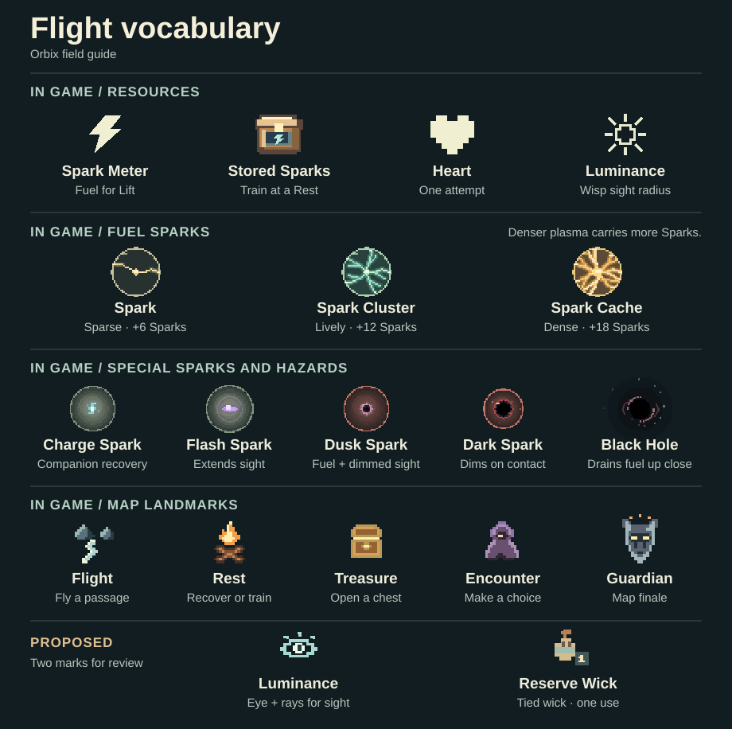

# A visual vocabulary for flight

Updated for the Collector build. The tables below describe the current game. The pictured sheet is an earlier three-size reference; the linked animated gallery contains the five current sizes.

The sheet uses still frames of the game’s pickup sprites, map landmarks and resource glyphs. Its Black Hole is a frame from the flight renderer. The last row shows a proposed one-use mark for the Reserve Wick. [Open the full-size PNG](./icon-language-sheet.png).

[Try the animated icons at menu size or enlarged](https://mocanumarius.github.io/orbix/spark-preview.html).

## Spark, Spark Meter and Stored Sparks

| Term | Picture | Player-facing meaning |
| --- | --- | --- |
| Spark | Plasma ball with bright electrical arcs | An object the wisp or Collector can pick up. Say “collect a Spark” when counting objects. |
| Spark Meter | The animated flight Spark marks a fuel quantity at menu size. The flight gauge uses stacked cells. | Measures the Sparks available for flight. An ordinary Lift spends 3 Sparks before modifiers. Meter divisions follow the equipped Lift cost. |
| Stored Sparks | A lidded copper box containing a luminous Spark | Currency for the current run. Store surplus from pickups, earn a clear reward where offered, and spend Stored Sparks on skills during the run, including from a paused flight. Baseline conversion stores 1 per 6 surplus Sparks. Kept Light is a separate skill that pays a capped dividend on currency carried into a cleared flight. |
| Luminance | Open eye with a jade iris and copper lids | Distance the wisp can see. Increasing Luminance reveals more of the passage. |
| Heart | Split-top heart, dimmed when spent | One attempt. A Rest can relight missing hearts. A heart and plus sign denotes increased capacity. |

Use **“a Spark adds 12 to the Spark Meter”** for the first explanation. Once that connection is familiar, use **“+12 Sparks”** beside the small plasma globe. **“Collect four Sparks”** counts objects. Every price and currency payout says **Stored Sparks** beside the box.

## What the pickup tells you

| Pickup or hazard | Readable cue | Base effect |
| --- | --- | --- |
| Spark | Warm-white arcs that flare and fade | +6 Sparks |
| Spark Cluster | Pale mint-white branches around a brighter core | +12 Sparks |
| Spark Cache | Dense white plasma with a broad halo | +18 Sparks |
| Surge Spark | A larger, finely detailed near-white plasma field | +36 Sparks |
| Giant Spark | The largest white plasma field, with secondary arc branches | +60 Sparks, appearing rarely |
| Flash Powerup | White glowing triangle on a trailing thread | Reveals the visible passage for 1.5 seconds. It pulses while attached for eight seconds, then dissolves into a puff. |
| Dusk Spark | Rose field surrounding a dark core | +12 Sparks and reduced Luminance for four seconds. |
| Dark Spark | Red warning field around a black seed | Reduces Luminance for eight seconds on contact. A fuel Spark clears one dimming effect. |
| Black Hole | Opaque core, bright tilted amber-white disk and inward streams of light | Persistent hazard. Approaching its core drains the Spark Meter faster. |

Keep the visible contact boundary separate from the plasma. Tutorial, map guide and pickup art should use the same frame and show the baseline amount plus any active build modifier. Use the density of live arcs, the brightness of the core and the width of the glow to suggest value at a glance. A pause or reduced-motion setting should keep every tier recognizable in a still image.

## Map and actions

Use the same five landmark families on the map, in the preview and in lessons. A glint travels along a mountain pass for flight. A campfire lifts sparks at a Rest. A treasure chest’s latch catches light. A standing figure carries a gently swinging lantern at an encounter. A guardian’s eyes glow in its distinctive mask. The elite uses a smaller creature silhouette. Unreachable and unselected future sites stay still, while a preview can carry the animation. Reduced motion keeps all five static.

Use a raised frame and a verb for actions. A highlighted path connects reachable destinations. Completed sites get a check. An unavailable skill shows its price or prerequisite when inspected. Signed gain and cost lines help readers distinguish effects independently of color.

## Companions and artifacts

Collector is the playable green orb. It catches missed helpful Sparks inside its recovering field. Direct contact with the main wisp takes priority. The Power indicator shows the current fetching range. The other companion portraits display locks, including in Test mode.

Use a distinct object portrait for each artifact. Glass Lantern has a glass chamber, Echo Bell a bell and clapper, and Prism Vessel a faceted container. The rarity frame is gray, green or purple, with the name in inspection. Use charge pips only for limited-use items. Artifacts accumulate and trigger automatically. Reserve Wick is a preparation from an event and uses a one-use pip.

## The first example

1. Show the paused flight at **24/30** on the Spark Meter. Point to a lively Spark Cluster in the passage and its **+12 Sparks** caption.
2. Collect it. Six Sparks fill the meter to **30/30**. The other six store **1 Stored Spark** in the copper box above it.
3. Tap Lift. The Spark Meter falls to **27/30**. The Stored Spark remains available to spend on run skills.

Split these into short, skippable beats. Use one moving highlight per beat, or static before-and-after states with reduced motion. Later tooltips should calculate the player’s actual Lift costs, gains and storage yield from the equipped build.

## Review in play

Check at 900×405, 740×333 and 667×320 CSS pixels with safe-area margins. Try the still art in grayscale. Ask a new player what tapping Lift spends, what Store does at a full meter, which pickups increase or decrease Luminance, and which resource buys a skill. Record the first mistaken interpretation to identify which silhouette or label needs work.

The production references are the [resource glyphs](../dist/game-symbols.mjs), [pickup sprites](../dist/pickup-art.mjs), [pickup effects](../dist/pickups.mjs), [display conversion](../dist/vitality.mjs), [companion controls](../dist/companion-abilities.mjs), [site choices](../dist/event-choices.mjs) and [map landmarks](../dist/map-landmarks.mjs).
